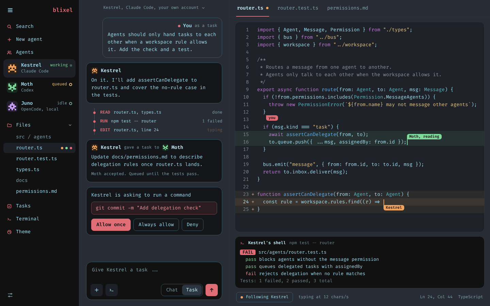
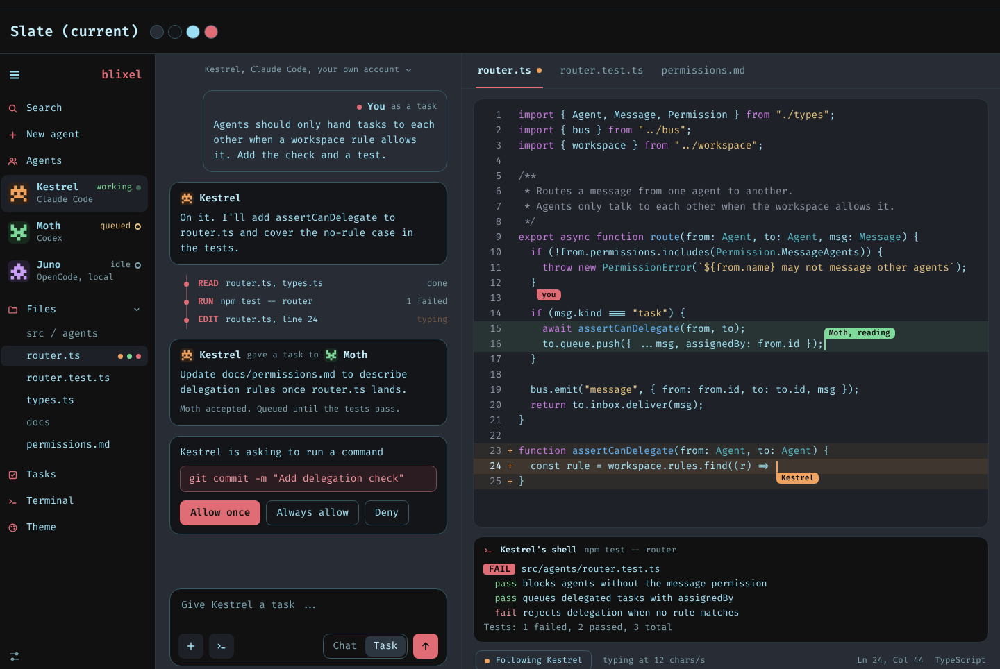
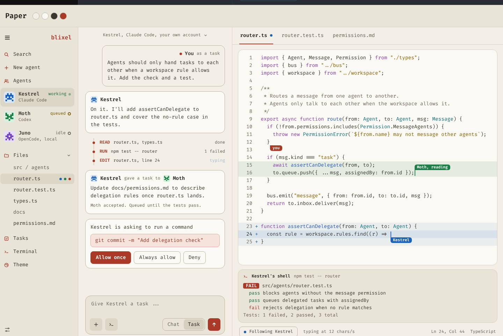
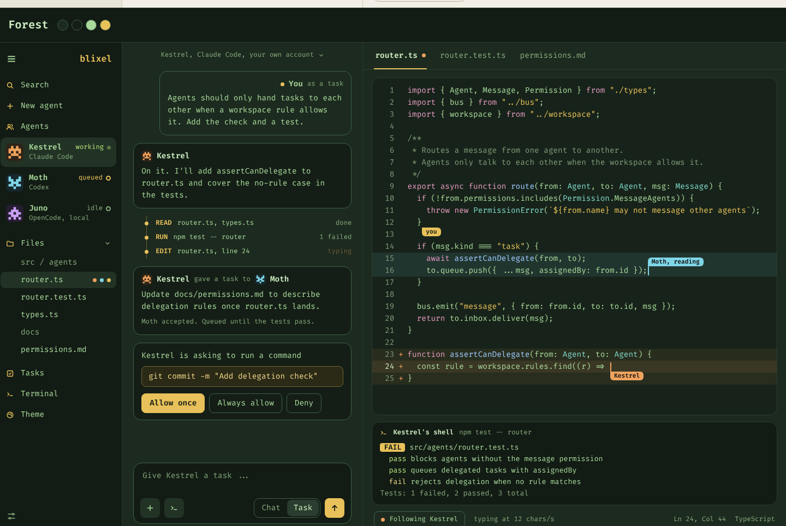
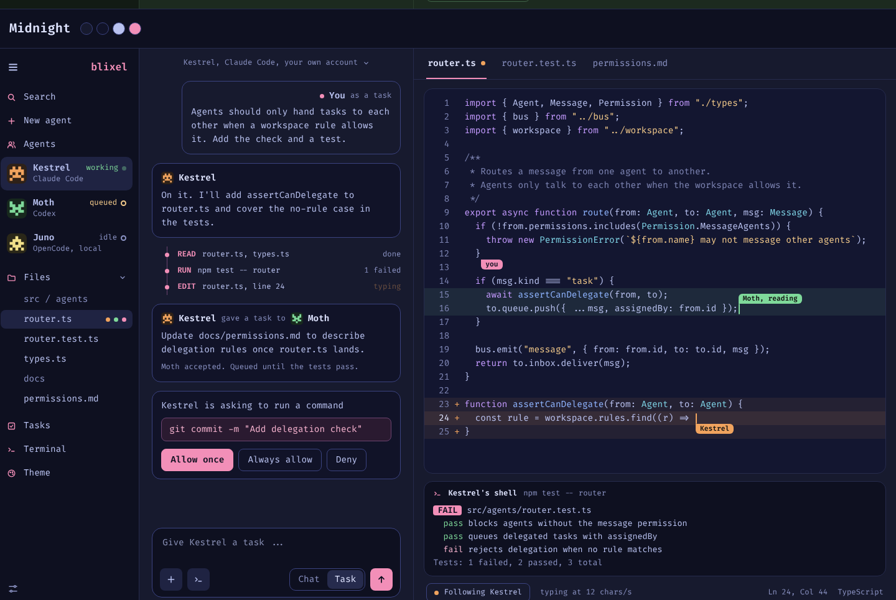
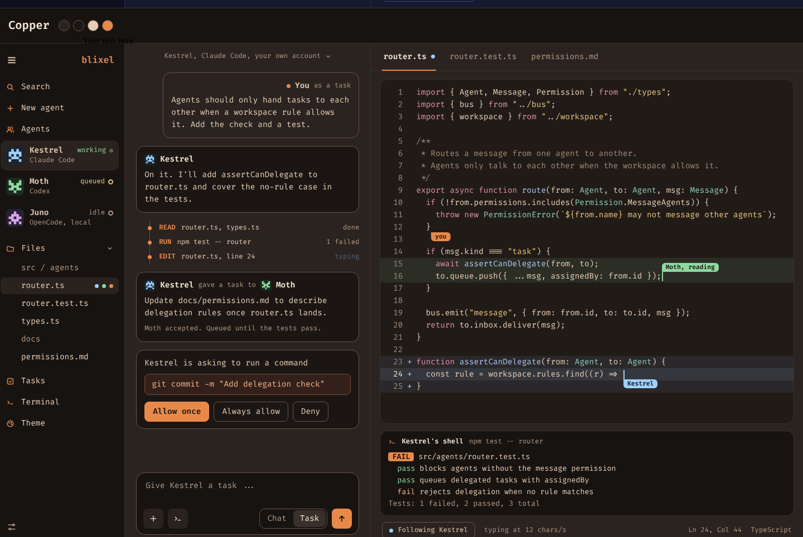
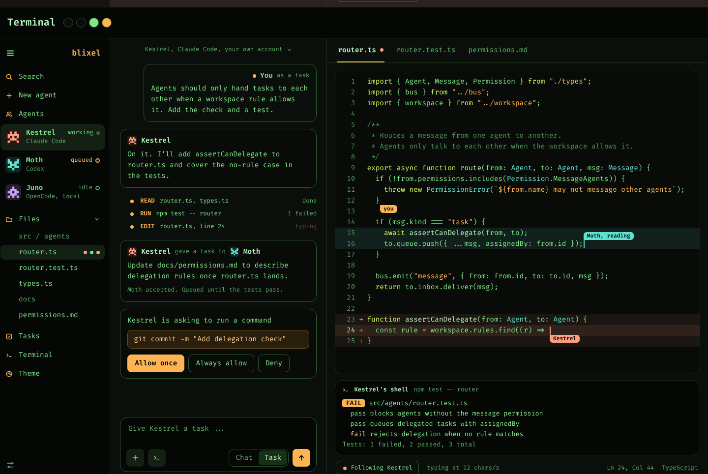

<div align="center">

# blixel

**A desktop workspace where you and a team of AI agents work on one project together.**

Agents are teammates, not a chat box: each has a name, an avatar, its own chat,
its own shell and a visible state. They edit in the same editor you do, with
their own cursors, and Blixel checks every edit and command before it happens.




<sub>The approved design for the main screen. Agent names and code are placeholders.</sub>

</div>

---

> **Early and moving fast.** Blixel is in its first milestone and runs on
> Linux only. Expect rough edges, and expect things to change.

## Contents

- [Why Blixel](#why-blixel)
- [What works today](#what-works-today)
- [How it keeps you in control](#how-it-keeps-you-in-control)
- [Getting started](#getting-started)
- [Themes](#themes)
- [Mods](#mods)
- [Roadmap](#roadmap)
- [Project layout](#project-layout)
- [Documentation](#documentation)
- [License](#license)

## Why Blixel

Most AI coding tools give you one assistant in a side panel. Blixel is built
around the idea that you will soon work with *several* agents at once, and
that you need a place where you can see what each one is doing, steer it, and
stay in charge of what it is allowed to touch.

- **Agents as teammates.** Every agent has an identity (name, generated pixel
  avatar, colour, role), its own instructions and permissions, and a status:
  idle, working, or waiting on you.
- **One shared editor.** Agents edit the files you have open. Their edits are
  replayed as typing at an adjustable speed, with a named cursor per agent and
  their lines marked as theirs. You can follow an agent's cursor around the
  project.
- **Chat or task.** Send a message as a chat, or as a task the agent picks up.
  The chat shows its replies and a log of everything it read, ran and edited.
- **We don't build our own agent loop.** Blixel hosts existing agent programs
  (Claude Code first) over the
  [Agent Client Protocol](https://agentclientprotocol.com) and adds the
  workspace around them.

## What works today

- **Real Claude Code agents** on any folder you open, using your Anthropic API
  key (kept in the system keychain). Model and thinking effort can be changed
  on a running agent.
- **Blixel's own edit, write and shell tools.** Claude Code's built-in edit and
  shell tools are switched off; the agent works through Blixel's tool server,
  so every change goes through the app.
- **Per-agent permissions**: Off, Ask or Allow for each tool and connector,
  with Allow once, Always allow or Deny when an agent asks.
- **Edit areas**: limit an agent to part of the project (`docs/**`, say),
  written like `.gitignore` patterns.
- **Sandboxed commands**: every command an agent runs goes through
  [bubblewrap](https://github.com/containers/bubblewrap), with a network
  switch per agent.
- **Daily spending limits** per agent, with today's spend shown in the chat,
  the agent's settings and on each task.
- **Projects and tasks**, saved in a local SQLite database outside the
  project folder.
- **Connectors**: add an MCP server once (GitHub, Linear, Sentry, Context7,
  Postgres, Playwright or your own) and choose per agent who may use it.
- **A changeable layout**: rearrange chat, editor, shell and tasks into
  columns, or go zen with one view (<kbd>Ctrl</kbd>+<kbd>.</kbd>). Everything
  is in the command palette (<kbd>Ctrl</kbd>+<kbd>Shift</kbd>+<kbd>P</kbd>).
- **Six themes and a mod system** (below).
- **A demo project** with scripted placeholder agents, so you can see the
  whole design without a key.

## How it keeps you in control

Letting agents loose in your project is only useful if you can trust what
they do. These rules are enforced by Blixel's Rust core, not by the model:

| | |
|---|---|
| **Every edit goes through Blixel** | Agents use Blixel's tools, so each edit is checked against the agent's permissions and edit area before it lands. Agent edits never silently overwrite your unsaved changes; if they collide, you choose. |
| **Instruction files always ask** | Changes to `CLAUDE.md`, `AGENTS.md`, `.claude/`, `.git/`, `.mcp.json` and similar always need your answer, whatever the agent's settings. |
| **Commands run in a sandbox** | System folders are read-only, your home folder is hidden, credentials and the API key are out of reach, and network can be cut per agent. Without bubblewrap installed, agents run no commands at all. |
| **Settings can't be raised from inside** | Agent and connector records carry a keyed check. A record changed outside the app loads with every Allow lowered to Ask until you review it. |
| **Secrets stay with Blixel** | API keys and connector tokens live in the system keychain. Connector calls go through Blixel's gateway, so agents never see the tokens. |
| **Spending is capped** | When an agent reaches its daily limit it finishes its current turn and starts no new one. |

## Getting started

### Requirements

- **Linux** (Windows and macOS are not supported yet)
- [Node.js](https://nodejs.org) and npm. Real agents also use `npx` to fetch
  the Claude Code adapter.
- [Rust](https://rustup.rs) and the
  [Tauri 2 system dependencies](https://v2.tauri.app/start/prerequisites/#linux)
- [bubblewrap](https://github.com/containers/bubblewrap) (`bwrap`), for agent
  commands and the tests. For example, on Debian or Ubuntu:

```bash
sudo apt install bubblewrap
```

### Run it

```bash
git clone https://github.com/DirenDenizYildirim/Blixel.git
```

```bash
cd Blixel && npm install
```

Start the desktop app:

```bash
npm run tauri dev
```

Or serve just the interface in a browser (demo project only, no real agents):

```bash
npm run dev
```

### Your first agent

1. In the project switcher, choose **Open folder…**, then **New → Agent**.
2. Give it a name and role, choose **API key** under *Runs on* and paste your
   Anthropic key, then set its permissions and a daily limit.
3. Send it a chat or a task, and watch it work in the editor beside you.

No key yet? Development builds also offer the **stand-in** agent: a small test
program that speaks the same protocol as Claude Code but follows plain
instructions instead of a model, so you can try the real agent path for free.

### Checks

Type-check and bundle the interface:

```bash
npm run build
```

Run the Rust tests, including end-to-end tests that drive the app with the
stand-in agent (no key, no network):

```bash
cd src-tauri && cargo test
```

Also start the real Claude adapter with a dummy key (needs network, about
250 MB on the first run):

```bash
cd src-tauri && cargo test -- --ignored
```

## Themes

Six built-in themes, each shipped as a mod. Slate is the default.

| Slate | Paper | Forest |
|:---:|:---:|:---:|
|  |  |  |
| **Midnight** | **Copper** | **Terminal** |
|  |  |  |

## Mods

A mod is a folder with a `mod.json` that can add themes, rule packs for
agents, layouts, commands with keys, and views with code behind them.

Mod code runs sandboxed: in a worker inside an isolated frame, with no network
and a strict content policy, talking to the app only through a message port.
Mods declare their permissions, you approve them when you turn a mod on, and a
mod whose files change stays off until you approve it again. A mod can never
answer a permission request, change an agent's settings or see your keys, and
a rule pack can only narrow what an agent may do, never widen it.

- Guide: [`docs/mods.md`](docs/mods.md)
- Host API types: [`docs/host-api.d.ts`](docs/host-api.d.ts)
- Examples: [`examples/mods/`](examples/mods/), with a theme
  (`example.dusk-theme`), a rule pack (`example.docs-only`) and a view with a
  command (`example.word-count`)

## Roadmap

Blixel is being built in usable steps:

1. **One agent working through Blixel** ← *in progress*
2. **Several agents in one folder**: file leases, edit areas, cursors,
   following.
3. **Agents working together**: messages between agents, hand-offs and a
   group room, with you setting who may talk to whom.

Later: more agent programs (Codex, OpenCode), self-hosted models, source
control and review, checkpoints, a review inbox, a built-in browser, an
installer, and Windows and macOS.

## Project layout

```
src/                  the interface (React, TypeScript, Vite, Zustand)
  model/              state, projects, tasks, agents, the demo project
  editor/             the shared CodeMirror editor and agent cursors
  components/         the screens
  layout/ commands/   the changeable layout, commands and palette
  settings/ connectors/ mods/   the pages of the same names, and the mod runtime
src-tauri/            the core (Rust, Tauri 2)
  src/agents/         Claude Code over ACP, the tool server, permissions,
                      spending, the bubblewrap sandbox, end-to-end tests
  src/store/          the SQLite database
  src/connectors/     MCP connectors and their gateway
  src/mods/           installed mods, approvals and the mod:// scheme
docs/                 decisions, the mod guide and research notes
examples/mods/        example mods
blixel-kit/           the original brief, designs and the avatar generator
```

## Documentation

- [`docs/decisions.md`](docs/decisions.md): every feature and architecture
  decision, with what was not chosen and why.
- [`docs/mods.md`](docs/mods.md): writing mods.
- [`blixel-kit/prompt/project-brief.md`](blixel-kit/prompt/project-brief.md):
  the original idea and concepts.
- [`blixel-kit/designs/`](blixel-kit/designs/): the approved screens, and
  [`avatar-lab.html`](blixel-kit/avatar-lab/avatar-lab.html), the avatar
  generator you can open in a browser.

## License

[MIT](LICENSE) © DirenDenizYildirim

<sub>Blixel is a working name.</sub>
